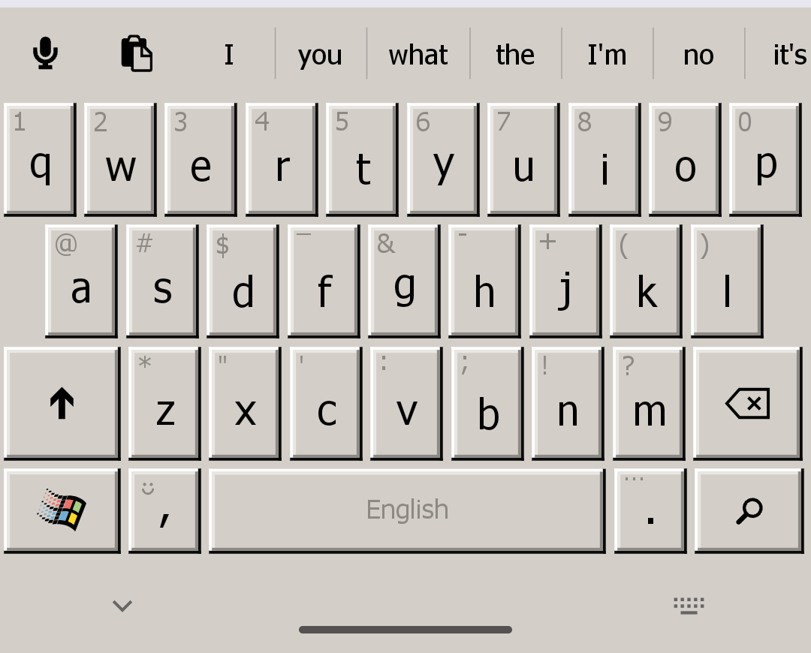
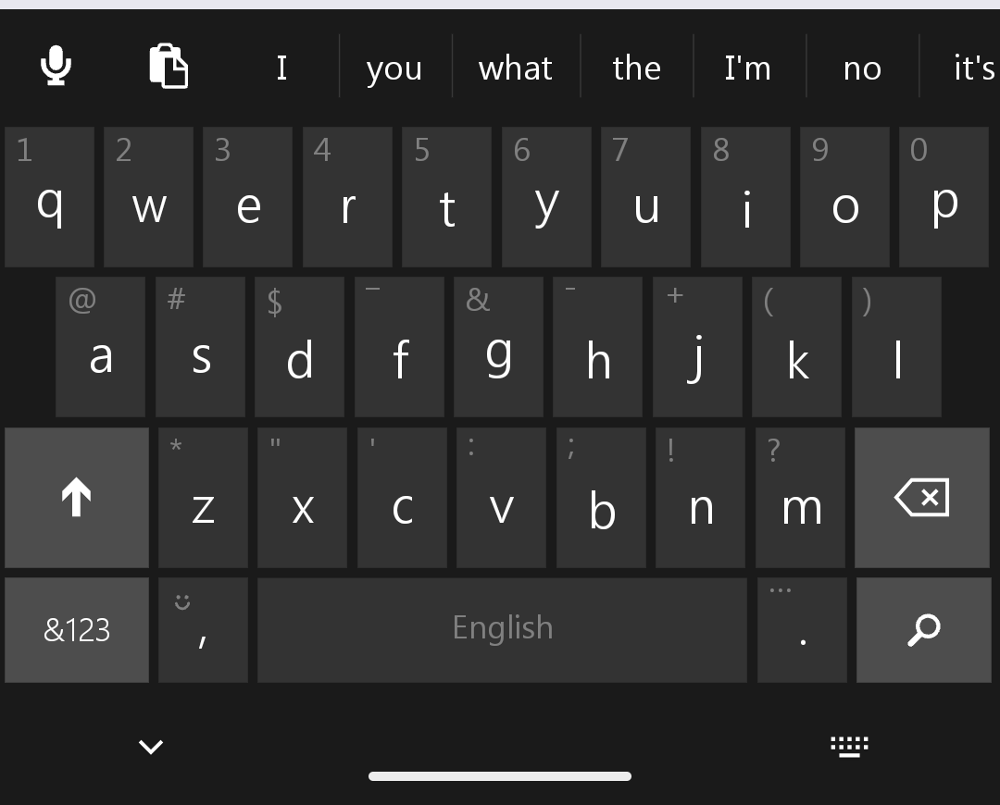
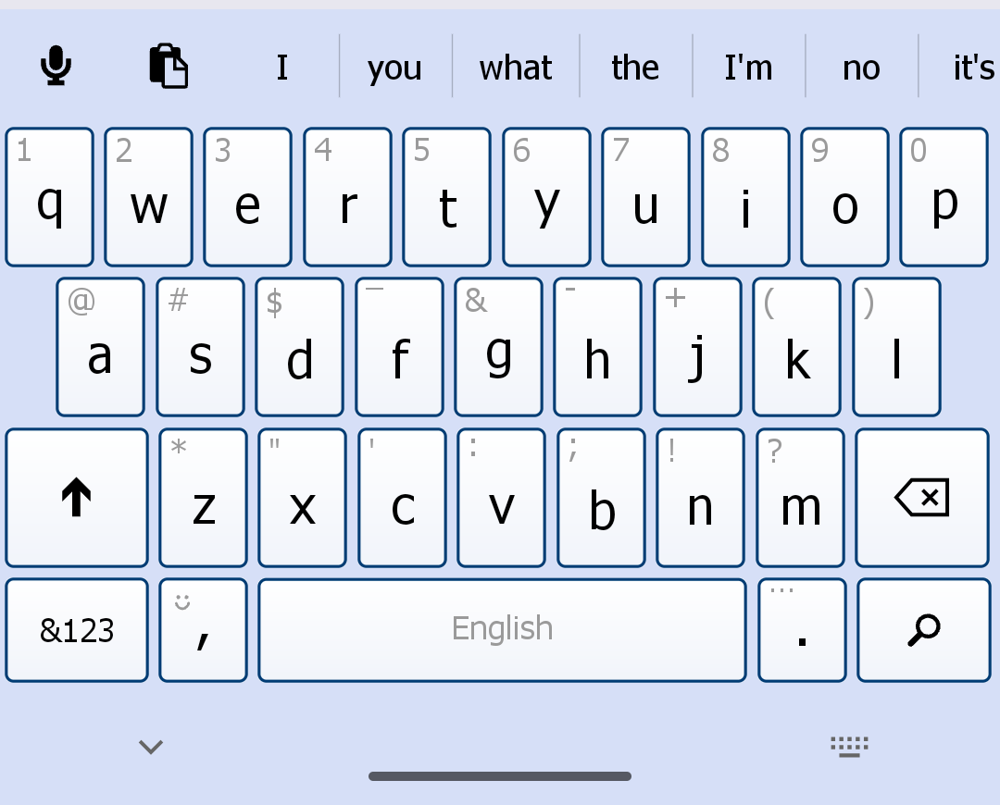
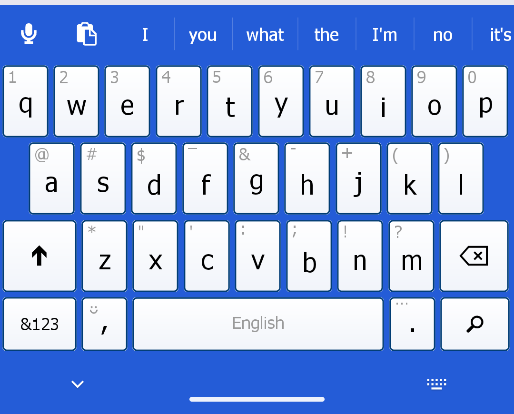
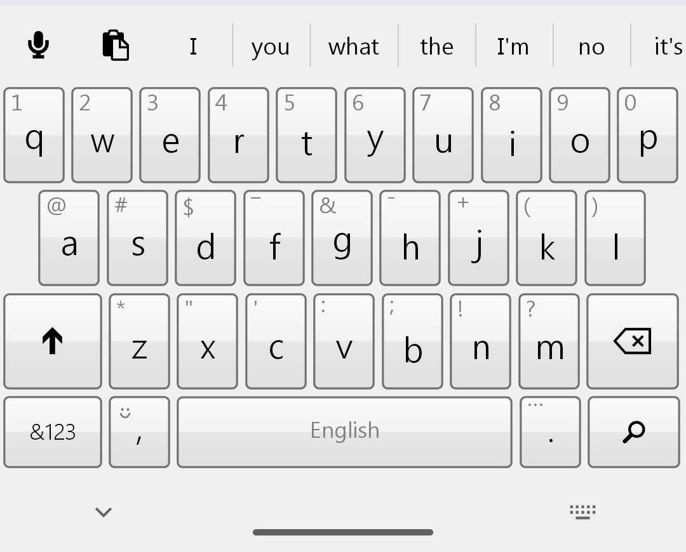
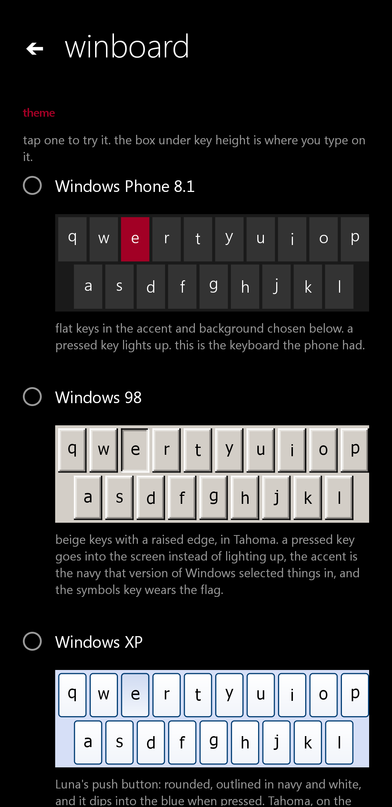

<h1 align="center">WinBoard</h1>

<p align="center">
  The Windows Phone 8.1 keyboard, as a keyboard — with Windows 98, XP and Vista for company.
</p>

<p align="center">
  
  
  
  
</p>

<p align="center">
  
</p>

WinBoard is an Android input method that types like the phone Microsoft stopped making. Ten
keys across, the digits and the symbols tucked into the corners where a hold produces them,
the space bar quietly naming the language you are typing in. Tap only — Windows Phone had no
glide typing and neither does this.

It began life inside a Windows Phone launcher, where it read that launcher's accent colour
across a process boundary and could not be installed on its own. This is the same keyboard
with all of that taken out: its own app, its own settings, no knowledge that any launcher
exists. Install it, turn it on, and it types into everything on the phone.

## Themes

Five keyboards, each drawn out of its own shell's push button — not one keyboard recoloured,
but that shell's actual button, with its own shape, its own font and its own idea of what a
key should do when you press it.

<table>
<tr>
<td width="50%" valign="top">
<br>
<b>Windows Phone 8.1</b><br>
Flat keys in an accent of your choosing, dark or light. A pressed key lights up. This is the
keyboard the phone had.
</td>
<td width="50%" valign="top">
<br>
<b>Windows 98</b><br>
Beige keys with a raised bevel, in Tahoma. A pressed key goes <i>into</i> the screen instead of
lighting up, and the symbols key wears the flag.
</td>
</tr>
<tr>
<td width="50%" valign="top">
<br>
<b>Windows XP</b><br>
Luna's push button: rounded, outlined in navy, white, dipping into the blue when pressed — on
the pale blue XP put behind the panels in every Explorer window.
</td>
<td width="50%" valign="top">
<br>
<b>Windows XP, taskbar</b><br>
The same keys on the blue of the taskbar itself. Louder, and the one XP surface everybody can
picture without being reminded of it.
</td>
</tr>
<tr>
<td width="50%" valign="top">
<br>
<b>Windows Vista</b><br>
Aero's button: the same shape in cool grey with the gloss line across the middle, answering a
press by going blue rather than by lighting up. Set in Segoe UI, the face Vista introduced.
</td>
<td width="50%" valign="top">
<br>
<b>Picked from a live preview</b><br>
Every theme on the settings page draws itself from the same code that draws the keyboard, so a
preview can never go stale — and the Windows Phone one shows <i>your</i> accent, because it has
no fixed appearance to photograph.
</td>
</tr>
</table>

## Features

- **Prediction and correction**, written in Kotlin with no native code — a packed trie, a
  bigram table and a proximity model that knows what sits next to what on the layout you are
  actually using. Correction is **off unless you ask for it**: suggestions are always offered
  and never imposed.
- **Twenty-two languages** across Latin, Greek and Cyrillic. English is the only one on to
  begin with; the rest are switches, and the globe in the navigation bar moves between
  whichever you turn on.
- **Emoji and GIFs** behind a hold on the comma, searchable, with recents.
- **The clipboard** on the suggestion bar — the last two hours of it, with anything the
  copying app marked sensitive kept in memory and never written to disk.
- **Dictation** that runs on the phone through [Vosk](https://alphacephei.com/vosk/), falling
  back to the platform recogniser for the languages Vosk publishes no model for.
- **A caret joystick**, a number row, adjustable key height, hold delay, haptics and keypress
  sounds — all optional, and all off unless they earn their place.

## Privacy

The words you type do not leave the phone. The word lists, the bigram tables, the emoji names
and every layout are compiled into the APK, and the dictionary of words WinBoard learns from
you lives in `noBackupFilesDir`, which Android's cloud backup does not touch. The backup rules
permit exactly one file: your settings.

Two things use the network, both only when you ask for them — downloading a Vosk model for
offline dictation, and searching GIPHY from the GIF panel. There are no analytics, no crash
reporting and no third-party SDKs of any kind.

GIPHY issues API keys per person, so none is built in. Paste your own into the **gifs** row of
the settings page; until you do, the panel says so rather than looking broken.

## Install

Grab the APK from [Releases](../../releases), or build it yourself:

```sh
git clone https://github.com/jovanovski/winboard.git
cd winboard
./gradlew :app:assembleDebug
```

`minSdk` 29 (Android 10), `compileSdk` 36. The only dependencies are AndroidX Core,
`android-gif-drawable` for the GIF grid, and Vosk with JNA for offline dictation.

## Turning it on

A keyboard cannot turn itself on. Open WinBoard and the top of the page tells you which of the
two steps is outstanding:

1. **Turn it on** — Android keeps a list of the keyboards a text box is allowed to use, and a
   freshly installed one is not on it.
2. **Choose it** — being allowed is not the same as being used.

Both open the system's own screens. Once both are done, the section disappears.

## How it is put together

| | |
|---|---|
| `keyboard/` | the input method: the grid, the keys, the panels, the popups, the service |
| `keyboard/text/` | prediction — dictionary, bigrams, proximity, composer, suggester |
| `keyboard/KeyboardTheme.kt` | the five themes, and the chrome each one draws a key with |
| `KeyboardSettings.kt` | everything the app remembers, in one preferences file |
| `KeyboardPalette.kt` | the accent and the light-or-dark, resolved |
| `Metro*.kt`, `TiltEffect.kt`, `SvgIcon.kt` | the Windows Phone furniture the settings page is built from |
| `tools/` | the scripts that build the word lists, the bigram tables and the emoji index |

Nothing here is laid out in XML. Every view is written in Kotlin and painted by hand, which is
how a key can be a Windows 98 bevel one moment and an Aero button the next without a single
resource being swapped.

## Credits

Word lists built from the OpenSubtitles frequency lists (CC BY-SA 3.0) via
[hermitdave/FrequencyWords](https://github.com/hermitdave/FrequencyWords), filtered against
[dwyl/english-words](https://github.com/dwyl/english-words). Next-word predictions counted
from the OpenSubtitles corpus through OPUS. Emoji names from Unicode CLDR. Offline speech
recognition by [Vosk](https://alphacephei.com/vosk/).

Windows, the Windows logo, Segoe UI and Tahoma are Microsoft's. This is a nostalgia project,
not affiliated with or endorsed by Microsoft in any way.

## Licence

GPL-3.0 — see [LICENSE](LICENSE), and [NOTICE](NOTICE) for what the licence does and does not
cover. The artwork and the fonts are not mine to relicense.
